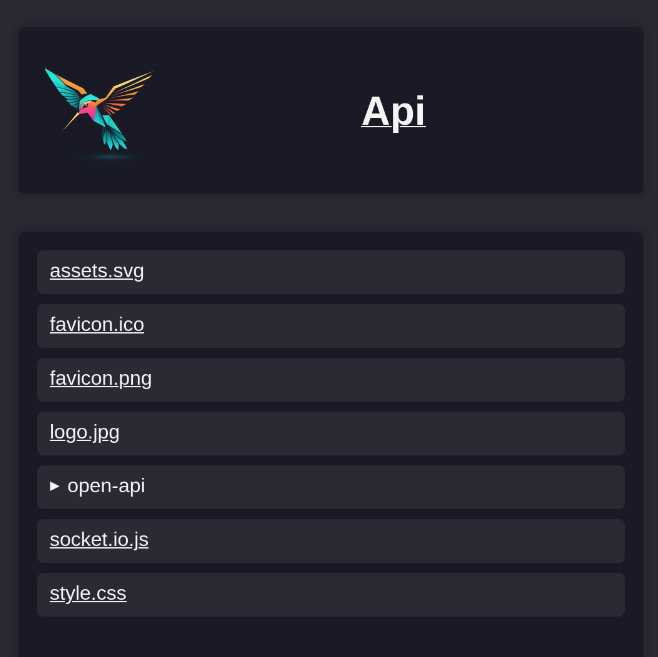

# Assets
Zibri offers a simple way to serve static files.

## Key exports
| Export | Kind | Purpose |
|---|---|---|
| `AssetServiceInterface` | interface | Serves files from your project's `assets/public` folder |
| `ZIBRI_DI_TOKENS.ASSET_SERVICE` | DI token | Injects `AssetServiceInterface` |
| `ZIBRI_DI_TOKENS.ASSETS_PATH` | DI token | The folder assets are read from |

## Usage
### Serving assets
Anything you put under your projects assets/public folder will served under `/assets/{asset-name-with-file-ending}` (With the default configuration).

### Where assets are read from
Zibri reads assets from the `assets` folder beside your bundle, which is where the build copies them.
Files are served from its `public` folder, and handlebars components are read from its
`templates/components` folder. Point it somewhere else with the `ASSETS_PATH` token:

```ts
import { defineProvider, FsUtilities, ZIBRI_DI_TOKENS } from 'zibri';

defineProvider({
    token: ZIBRI_DI_TOKENS.ASSETS_PATH,
    useFactory: () => FsUtilities.getPath('/var/lib/my-app/assets')
})
```

### File explorer
For documentation purposes there is also a simple "file explorer" page provided by Zibri under `/assets` when not specifying an asset, that can also be reached from the root page:



## See also
- [Templating](./templating.md) — referencing assets (eg. scripts, icons) from rendered pages
