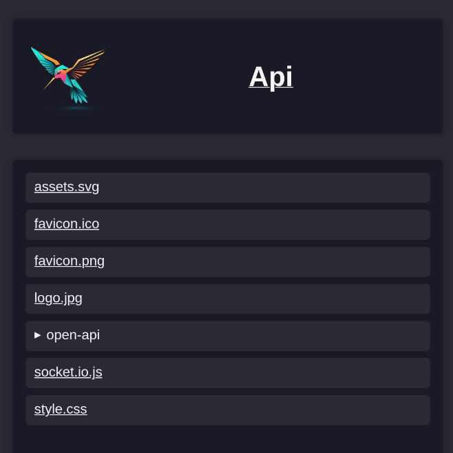

# Assets
Static files in your project's `assets/public` folder, such as images, scripts and stylesheets, are served under `/assets`.

## Key exports
| Export | Kind | Purpose |
|---|---|---|
| `AssetServiceInterface` | interface | Serves files from your project's `assets/public` folder |
| `ZIBRI_DI_TOKENS.ASSET_SERVICE` | DI token | Injects `AssetServiceInterface` |
| `ZIBRI_DI_TOKENS.ASSETS_PATH` | DI token | The folder assets are read from |
| `FsUtilities` | class | Reads and writes files, and builds paths with `getPath` |
| `FsPath` | type | A file system path, as `FsUtilities.getPath` returns it |

## Serving assets
A file in your project's `assets/public` folder is served under `/assets/{file-name-with-extension}`.

## Where assets are read from
Assets are read from the `assets` folder beside your bundle, which is where the build copies them.
Files are served from its `public` folder, and Handlebars components are read from its
`templates/components` folder. Point it somewhere else with the `ASSETS_PATH` token:

```ts
// src/providers.ts
import { defineProvider, FsUtilities, ZIBRI_DI_TOKENS } from 'zibri';

defineProvider({
    token: ZIBRI_DI_TOKENS.ASSETS_PATH,
    useFactory: () => FsUtilities.getPath('/var/lib/my-app/assets')
})
```

## Browsing the assets
`/assets` without a file name shows a file explorer of the public assets. The root page links to it:



## See also
- [Templating](./templating.md) — referencing assets (such as scripts, icons) from rendered pages
